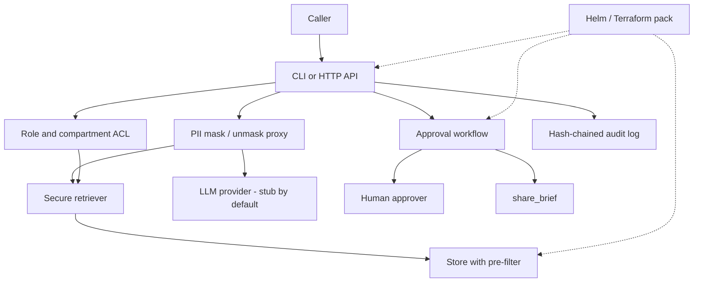

# Watchfloor Assistant

A need-to-know retrieval assistant. It answers questions only from documents a caller is allowed to see, replaces sensitive identifiers with deterministic tokens before any model call, and will not complete a high-stakes share until a human approves — even if the process exits mid-wait.

The default path runs fully offline: an in-memory (or Postgres) store, a stub model provider, and a sqlite-backed approval workflow. Anthropic and Vertex are optional. Keys stay in the environment.

This is a demonstration tool, not a production or accredited system. Sample documents are fictional and unclassified.

## Features

- **Compartment-filtered retrieval.** Document chunks are labeled `ops`, `finance`, or `shared`. The store pre-filters by the caller's compartments, then ranks. A post-filter would be too late.
- **Deterministic PII proxy.** SSN-like, card-like, and email-like spans are swapped for stable `[PII:KIND:…]` tokens, stored in a vault, and restored only for roles that may see them. Raw identifiers never go to the model stub.
- **Hash-chained audit log.** Each event is appended with `prev_hash` and `entry_hash`. The log records tokens and actions, not raw planted identifiers. `watchfloor audit --verify` checks the chain.
- **Durable approval gate.** `share_brief` starts a pending workflow, notifies a stubbed (optional Slack) channel, and stays pending until `approve` or `deny`. State lives in sqlite, so a restart does not lose the wait.
- **Offline-first providers.** The LLM interface defaults to a template stub. Anthropic and Vertex can be selected with environment variables. Tests never call the network.
- **Deploy pack.** Docker Compose for a laptop demo, Terraform for a Google Cloud private VPC (Cloud Run, no public ingress, Private Google Access, VPC Service Controls notes), and a Helm chart with default-deny egress.

## Architecture



Request path: identify the caller → pre-filter the document set by compartment → mask sensitive spans → retrieve → generate from masked context → restore tokens only if the role allows it → if the caller requests a share, start a workflow and wait.

## Quickstart

Requires Python 3.12+. No API key is needed for the default stub provider.

```bash
python3 -m venv .venv
source .venv/bin/activate
pip install -e ".[dev]"
pytest -q
ruff check src tests
```

GitHub Actions runs lint and tests on each push and pull request to `main`.

Ask the same question as two different fixture users:

```bash
watchfloor ask --user ops-lead --query "What is in the Harborline Carriers payment memo?"
watchfloor ask --user finance --query "What is in the Harborline Carriers payment memo?"
```

The site operations lead does not retrieve finance-compartment chunks. The finance user does, and (because that role may reveal identifiers) sees planted values restored in the answer only. The model prompt still contains tokens, not the raw values. Inspect the chain:

```bash
watchfloor audit --verify --tail 20
```

Request a share, restart the process, and approve it. The pending work is still there:

```bash
watchfloor share --user ops-lead --summary "Share the weekly site brief with Harborline Carriers"
watchfloor pending
# Note the approval id, then in a new shell (or after a restart):
watchfloor approve --user approver --id <approval-id> --reason "Packet is already on the visitor desk"
```

Serve the HTTP API (same fixture users, `X-User-Id` header):

```bash
watchfloor serve --host 127.0.0.1 --port 8080
# POST /ask, /actions/share, /approvals/{id}/approve, /approvals/{id}/deny
# GET  /health, /approvals, /approvals/{id}, /audit
```

### Docker Compose (offline demo)

```bash
docker compose up --build
# http://127.0.0.1:8080/health
```

The default compose file uses the stub provider and in-process approvals. Add `--profile postgres` to run Postgres (pgvector image) and point the API at it. Pull images while connected; after that the stack does not need the public internet.

### Google Cloud private VPC

See [`deploy/terraform/README.md`](deploy/terraform/README.md) for a private VPC, Private Google Access, internal-only Cloud Run, and VPC Service Controls notes. The Helm chart under [`deploy/helm/watchfloor`](deploy/helm/watchfloor) deploys the API with a default-deny egress NetworkPolicy.

An egress probe lives at `deploy/scripts/egress-smoke.sh`. In a closed perimeter it should fail to reach a public URL.

## Fixture users and documents

All names, invoices, and identifiers are invented.

| User id    | Role        | Compartments      | May reveal PII | May approve |
|------------|-------------|-------------------|----------------|-------------|
| `ops-lead` | site_ops    | ops, shared       | no             | no          |
| `finance`  | finance     | finance, shared   | yes            | no          |
| `approver` | approver    | shared            | no             | yes         |

Documents under `testdata/` carry YAML front matter with a `compartment`. Finance notes include planted SSN-like, card-like, and email-like values so the proxy can be tested. Do not replace them with real identifiers.

## Pilot plan

- **Baseline:** Staff assemble briefs by hand from shared drives. Need-to-know is informal. During a disconnected period the assistant is simply unavailable. Outbound shares have no recorded approval.
- **Success measures:** Zero unauthorized document hits on the fixture ACL tests. 100% of planted sensitive spans are tokenized before inference. Approval workflows resume after a hard process restart. A closed-perimeter smoke test shows no public egress. A short demo can be run from a cold install or `docker compose up`.
- **First shippable slice:** Compartment-filtered retrieval, PII mask/unmask with a hash-chained audit log, one durable share-approval workflow, and a Compose (plus private-VPC pack) deploy on the fixture set.
- **First users:** The three fixture users in the demo script below.

## Demo script

Setting: fictional company **Northbridge Logistics**, Riverside distribution center. The assistant should keep working when the site network link is down. Data is unclassified fiction.

1. Run `pytest -q` and, if you are showing the perimeter, `deploy/scripts/egress-smoke.sh` from a closed network (it should not reach the public internet).
2. As `ops-lead`, ask for the Harborline payment memo. Citations stay in ops/shared documents. The finance memo is absent.
3. As `finance`, ask the same question. The finance memo is cited. Open `watchfloor audit --json` and show `mask_chunk` then `infer` then `unmask_response`. The audit entries list tokens, not the planted card or tax identifier. The model prompt (in `--json` output) also has no raw planted values.
4. As `ops-lead`, request a share of the weekly site brief with Harborline Carriers. Show `pending`. Stop the process (or just start a new shell with the same `WATCHFLOOR_DATA_DIR`). The approval is still open. As `ops-lead`, an approve call is rejected. As `approver`, deny once, then approve a second request. The decision is recorded in the audit log.

High-stakes verbs in this tool are "share" or "open a ticket." There is no control or release action.

## Configuration

Copy `.env.example` to `.env` if you want local overrides. Never commit keys.

| Variable | Default | Purpose |
|----------|---------|---------|
| `WATCHFLOOR_LLM_PROVIDER` | `stub` | `stub`, `anthropic`, or `vertex` |
| `ANTHROPIC_API_KEY` | unset | Required only for the Anthropic provider |
| `GOOGLE_CLOUD_PROJECT` | unset | Required only for the Vertex provider |
| `WATCHFLOOR_DATABASE_URL` | unset | Empty uses the in-memory store; set for Postgres |
| `WATCHFLOOR_WORKFLOW_BACKEND` | `inprocess` | `inprocess` (sqlite, crash-safe) or `temporal` when a cluster is wired |
| `WATCHFLOOR_DATA_DIR` | `./data` | Audit log and approval state |

A Temporal backend is reserved for a running cluster; the laptop demo and all tests use the in-process store so they stay offline and still survive a restart.

## Security note

Read [`SECURITY.md`](SECURITY.md). Use fictional, unclassified intake only. Do not paste real personal data, real customer documents, or real organization identifiers. Role labels (`ops`, `finance`, `shared`) are demo access tags, not government classification markings. The Terraform and Helm packs illustrate a zero-public-egress pattern; they are not an authority to operate.

## License

MIT. Copyright (c) 2026 Goose0x.
